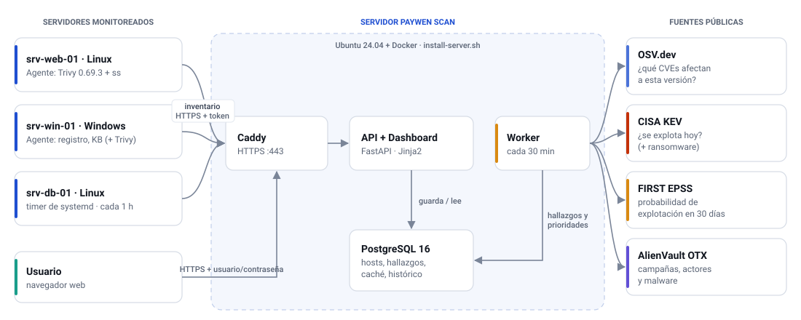

# Paywen Scan

**Priorización de vulnerabilidades según explotación real e inteligencia de amenazas.**

Paywen Scan recolecta el inventario de software de tus servidores Linux y Windows, lo cruza con fuentes públicas de vulnerabilidades e inteligencia de amenazas y muestra en un dashboard qué parchar primero y por qué.

Proyecto del Diplomado en Ciberseguridad, Educación Profesional UC (2026) · Grupo 4, Los seguritos: Bruno Acevedo, Felipe Bazares, Fernando Martinez, Francisco Leiva, Gonzalo Rojas y Victor Ponce.



## Por qué

Un servidor típico acumula miles de vulnerabilidades conocidas. Ordenarlas solo por gravedad (CVSS) deja cientos marcadas como urgentes y no distingue las que ya se están explotando. Paywen Scan combina tres tipos de información:

- **Explotación confirmada:** el catálogo [CISA KEV](https://www.cisa.gov/known-exploited-vulnerabilities-catalog), con la marca de uso en ransomware.
- **Probabilidad de explotación:** [FIRST EPSS](https://www.first.org/epss/), un modelo de aprendizaje automático que estima la probabilidad de explotación en los próximos 30 días.
- **Contexto propio:** qué está instalado en cada servidor, según [OSV.dev](https://osv.dev), y qué está expuesto en la red. Además, las campañas de [AlienVault OTX](https://otx.alienvault.com) que mencionan cada CVE.

En el laboratorio del proyecto, de 11.999 hallazgos la regla dejó 31 como críticos (0,3 %), entre ellos todas las vulnerabilidades presentes en KEV.

## Cómo funciona

1. Un **agente** en cada servidor envía su inventario por HTTPS, con un token:
    - en Linux, paquetes y librerías con Trivy, y puertos con `ss`;
    - en Windows, programas, parches KB, puertos y, opcionalmente, librerías con Trivy.
2. La **API** valida y guarda el inventario.
3. El **worker**, cada 30 minutos, lo cruza con OSV, KEV, EPSS y OTX, calcula las prioridades y guarda una foto diaria de cada servidor.
4. El **dashboard** muestra el resumen, los servidores y el estado de su agente, los hallazgos con filtros, el histórico, las campañas y la documentación.

### Regla de prioridad

| Condición | Prioridad |
|---|---|
| El CVE está en CISA KEV | Crítica |
| EPSS ≥ 10 % | Alta |
| Resto: CVSS ≥ 9 / ≥ 7 / menor | Alta / Media / Baja |
| El paquete está detrás de un puerto en escucha | +1 nivel |

## Estructura del repositorio

| Carpeta | Qué contiene | Guía |
|---|---|---|
| [`server/`](server/) | Instalador del servidor completo con Docker (API, worker, PostgreSQL y HTTPS con Caddy), comando de administración `paywen-server` y el código de la aplicación en [`server/app/`](server/app/) | [`server/README.md`](server/README.md) |
| [`agent-linux/`](agent-linux/) | Agente de Linux (Bash + Trivy 0.69.3) y su instalador | [`agent-linux/README.md`](agent-linux/README.md) |
| [`agent-windows/`](agent-windows/) | Agente de Windows (PowerShell 5.1), instalador y agente en un solo archivo | [`agent-windows/README.md`](agent-windows/README.md) |
| [`docs/`](docs/) | Diagrama de arquitectura | |

La documentación completa (descripción general, guías y novedades) está en [`server/app/paywen/manual/`](server/app/paywen/manual/) y también dentro del dashboard, en la sección **Docs**.

## Inicio rápido

**1. Servidor** (Ubuntu 24.04, con salida a internet):

```bash
git clone https://github.com/victorhponcec/paywen_scan.git paywen-scan
cd paywen-scan/server
sudo ./install-server.sh
sudo paywen-server credentials        # URL, usuario, contraseña y token de agentes
sudo paywen-server agent-command      # comando listo para instalar los agentes
```

**2. Agente de Linux**, en cada servidor que quieras monitorear:

```bash
cd paywen-scan/agent-linux
sudo ./install.sh --url https://SERVIDOR --token TOKEN --name srv-web-01 --interval 1h
# con certificado interno (servidor por IP): agregar --insecure
```

**3. Agente de Windows**, en PowerShell de 64 bits como administrador:

```powershell
cd C:\PaywenSetup\agent-windows
Unblock-File .\install.ps1
.\install.ps1 -Url "https://SERVIDOR" -Name "srv-win-01"
# opcional: -InstallTrivy -ScanPaths "C:\apps"     con certificado interno: -Insecure
```

**4.** Abre la URL del servidor en el navegador. Los hallazgos aparecen después de la primera pasada del worker (`sudo paywen-server worker` para lanzarla ahora).

## Seguridad

- **Agentes:** inician la conexión, así que no necesitan puertos de entrada. Envían solo nombres y versiones de software y puertos, nunca contenido de archivos ni credenciales.
- **Comunicaciones y acceso:** todo viaja por HTTPS. Los agentes usan un token y el dashboard, usuario y contraseña.
- **Base de datos:** está en una red interna, sin puertos publicados. La aplicación la usa con un usuario sin privilegios de administración y corre en contenedores sin root.
- **Contraseñas:** se generan al azar en `server/.env`, con permisos 600. **No subas ese archivo al repositorio.**
- **Dashboard:** no usa JavaScript ni recursos externos y aplica una política CSP estricta.
- **Trivy:** queda fijado en la versión 0.69.3, porque la 0.69.4 fue comprometida (CVE-2026-33634). En Windows, el agente verifica su SHA-256.

## Limitaciones

- **Windows:** los programas y parches KB se muestran como inventario, porque OSV no tiene datos de vulnerabilidades de Windows. Las librerías que detecta Trivy sí se cruzan. El cruce con los boletines de Microsoft (MSRC) es trabajo futuro.
- **Exposición:** se deduce del proceso que escucha en cada puerto, no de un escaneo de red.
- **Puntaje de riesgo por servidor:** se satura en 100 cuando hay muchos hallazgos.

## Desarrollo

El código de la aplicación (Python 3.12, FastAPI, PostgreSQL) y sus pruebas están en [`server/app/`](server/app/). Ver [`server/app/README.md`](server/app/README.md) para construir la imagen, levantar un entorno local y correr las pruebas.

## Créditos

- Íconos: [Lucide](https://lucide.dev) (licencia ISC; ver `server/app/paywen/static/icons/LICENSE.txt`).
- Datos de vulnerabilidades: OSV.dev, CISA KEV, FIRST EPSS y AlienVault OTX, según sus propias condiciones de uso.
